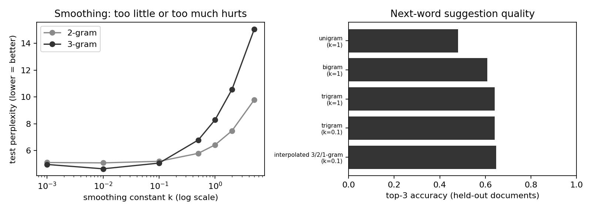

<div align="center">
  <!-- En-tête créatif -->
  

  <!-- Animation texte ciblant "Ce que fait le projet" et "Pourquoi c'est utile" -->
  

  <br/>

  <!-- Badges recommandés par GitHub -->
  <p>
    
    
    
    
  </p>
</div>

---

<!-- 1. CE QUE FAIT LE PROJET -->
## À propos du projet

**Smart Keyboard** est un moteur de saisie prédictive et d'autocomplétion en temps réel basé sur les modèles de langage statistiques n-grammes (Unigramme, Bigramme, Trigramme) avec lissage de Laplace (*add-k*), repli hiérarchique (*hard back-off*) et interpolation de Jelinek-Mercer. Conçue pour le traitement automatique du langage naturel (TALN / NLP), cette application permet aux utilisateurs et développeurs de bénéficier de suggestions instantanées au frappe-par-frappe avec une latence sub-milliseconde, sans avoir à déployer des modèles neuronaux lourds ou énergivores.

> [!NOTE]
> Pour une vue détaillée des choix de conception, des algorithmes probabilistes et des schémas système, consultez la [documentation d'architecture](docs/ARCHITECTURE.md).

<!-- APERÇU VISUEL (GIF + CAPTURES D'ÉCRAN) -->
### Aperçu en action

<div align="center">
  
  <p><em>Évaluation expérimentale : compromis entre constante de lissage k et perplexité, et précision Top-3 comparative des modèles sur corpus de test.</em></p>
</div>

<details>
  <summary><b>Voir plus de détails (Fonctionnalités de l'interface & Raccourcis)</b></summary>
  <br/>

  L'application dispose d'une interface SaaS réactive offrant :
  - **Saisie en direct avec autocomplétion :** Détection automatique du mot en cours de frappe et proposition des complétions les plus probables.
  - **Prédiction du mot suivant :** Suggestions contextuelles immédiates dès qu'un mot est validé.
  - **Raccourcis clavier productifs :**
    - <kbd>Tab</kbd> : Compléter immédiatement le mot en cours.
    - <kbd>→</kbd> : Insérer la meilleure suggestion de mot suivant.
    - <kbd>Clic</kbd> : Insérer n'importe quelle carte de suggestion.
  - **Jauges radiales de confiance :** Score normalisé (0–100%) et badge d'accréditation du niveau de n-gramme source (*3-gram*, *2-gram*, *1-gram*).
  - **Sélecteur de thème :** Bascule instantanée Dark / Light Mode.
</details>

<!-- 2. POURQUOI LE PROJET EST UTILE -->
## Pourquoi utiliser ce projet ?

Ce projet répond aux contraintes de latence, de légèreté et de fiabilité mathématique rencontrées dans les interfaces de saisie modernes :

- **Inférence instantanée (sub-milliseconde) :** Grâce à des structures de données optimisées en mémoire (`defaultdict`, `Counter`) et un micro-serveur HTTP multithreadé dédié, les prédictions sont servies en moins d'une milliseconde (~0.3 ms), garantissant une fluidité parfaite à 60 FPS.
- **Lissage robuste Add-k & Stratégies Hybrides :** Élimine le problème des probabilités nulles sur le vocabulaire non rencontré en contexte grâce au lissage de Laplace add-k ($k \in [0.01, 1.0]$), combiné à un repli adaptatif (*hard back-off* Trigramme $\rightarrow$ Bigramme $\rightarrow$ Unigramme) et une interpolation atteignant **64.7% d'accuracy Top-3**.
- **Architecture découplée & Zéro dépendance GPU :** Fonctionne de manière 100% autonome sur CPU avec une empreinte mémoire minimale, tout en supportant les corpus massifs (dataset Hugging Face *Allociné*) et les corpus locaux hors-ligne.

### Stack Technique

| Couche | Technologies |
| :--- | :--- |
| **Backend & Inférence** | `Python 3.10+`, `HTTPServer` (micro-serveur multithreadé daemon) |
| **Frontend & UI** | `Streamlit`, Composant personnalisé `HTML5 / CSS3 / Vanilla JS`, `Font Awesome 6` |
| **Données & NLP** | Modèles N-grammes (1/2/3-gram), `Hugging Face Datasets` (corpus Allociné), `Matplotlib` |
| **Évaluation & Métriques** | Perplexité (PPL), Précision Top-K, Split par document reproductible |

<!-- 3. COMMENT DÉMARRER -->
## Pour commencer

Suivez ces instructions pour déployer et exécuter une instance locale du projet pour le développement et les tests.

### Prérequis

Assurez-vous d'avoir installé les outils suivants sur votre environnement :

- `Python` (v3.10 ou supérieur)
- `pip` (gestionnaire de paquets Python)
- `Git`

### Installation

1. **Cloner le dépôt**
   ```bash
   git clone https://github.com/essoktani-yazid/smart_keyboard.git
   cd smart_keyboard
   ```

2. **Créer et activer un environnement virtuel**
   ```bash
   python -m venv .venv
   source .venv/bin/activate  # Sur Windows: .venv\Scripts\activate
   ```

3. **Installer les dépendances**
   ```bash
   pip install -r requirements.txt
   ```

### Démarrage de l'application

Lancez l'interface interactive Streamlit :

```bash
streamlit run app.py
```

L'application démarre automatiquement le micro-serveur d'inférence en tâche de fond et ouvre l'interface sur `http://localhost:8501`.

### Exemple d'utilisation

Une fois l'application lancée, le micro-serveur d'inférence écoute sur le port local (par défaut `http://127.0.0.1:8555`). Vous pouvez interroger directement l'API en ligne de commande :

```bash
# Vérifier l'état de préparation du modèle
curl http://127.0.0.1:8555/api/health

# Obtenir des suggestions de complétion et de mot suivant
curl -G "http://127.0.0.1:8555/api/suggest" \
  --data-urlencode "text=le film est" \
  -d "k_comp=4" \
  -d "k_next=4"
```

*Pour découvrir l'ensemble des endpoints et paramètres disponibles, consultez la [Référence API complète](docs/API.md).*

### Reproduction des benchmarks

Pour exécuter la suite complète d'évaluation (perplexité, taux de zéros, accuracy top-3 et balayage de $k$) :

```bash
python -m src.evaluate
```

Les métriques et graphiques sont sauvegardés dans le dossier `results/` (`metrics.json`, `failures.txt`, `ngram_results.png`).

### Structure du projet

```text
.
├── app.py               # Interface SaaS Streamlit avec composant moderne Vanilla JS
├── src/
│   ├── pipeline.py      # Cœur NLP : NGramModel, InterpolatedModel, backoff_top_k
│   ├── server.py        # Micro-serveur HTTP pour inférence en temps réel (< 1ms)
│   └── evaluate.py      # Benchmarks quantitatifs (Perplexité, Top-3, sweep de k)
├── data/
│   ├── corpus.csv       # Corpus de secours structuré en documents et phrases
│   └── make_data.py     # Script de génération du corpus synthétique (seed 42)
├── results/
│   ├── metrics.json     # Résultats d'évaluation structurés au format JSON
│   ├── failures.txt     # Analyse des erreurs et des contextes non rencontrés
│   └── ngram_results.png# Graphiques comparatifs générés par Matplotlib
├── docs/
│   ├── assets/          # Ressources graphiques et schémas
│   ├── API.md           # Spécification détaillée des endpoints du micro-serveur
│   └── ARCHITECTURE.md  # Choix de conception, flux de données et diagrammes Mermaid
├── requirements.txt     # Dépendances du projet (streamlit, datasets, matplotlib)
├── LICENCE              # Licence MIT
└── README.md            # Documentation principale
```

<!-- 4. AIDE & SUPPORT -->
## Aide et Support

Vous avez une question sur l'architecture ou l'implémentation du projet ?
- **Documentation :** Consultez les fichiers techniques présents dans le dossier [`docs/`](docs/).
- **Contact direct :** N'hésitez pas à me contacter directement via LinkedIn ou mon portfolio.

<!-- 5. CONTRIBUTION & AUTEUR -->
## Contribuer

Les contributions et propositions d'améliorations sont les bienvenues !
1. **Forkez** le projet
2. Créez votre branche de fonctionnalité (`git checkout -b feature/NouvelleFonctionnalite`)
3. Commitez vos changements (`git commit -m 'feat: Ajout de NouvelleFonctionnalite'`)
4. Pushez vers la branche (`git push origin feature/NouvelleFonctionnalite`)
5. Ouvrez une **Pull Request**

## Auteur

<div align="center">

**Yazid ESSOKTANI**  
*Full-Stack Web & AI Developer*

[](https://www.essoktani.tech/)
[](https://www.linkedin.com/in/yazid-essoktani-337549251)
[](https://github.com/essoktani-yazid)

</div>

---

## Licence

Distribué sous la licence **MIT**. Consultez le fichier [`LICENCE`](LICENCE) pour plus d'informations.
