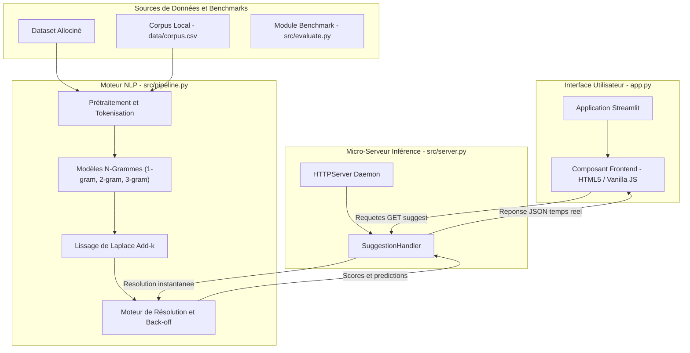
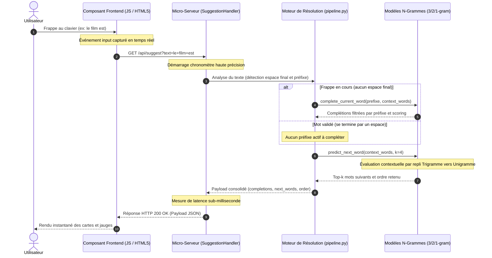

# Architecture du Système — Smart Keyboard

> Ce document décrit l'architecture technique, les choix de conception et les flux de données de **Smart Keyboard**, un moteur de saisie prédictive et d'autocomplétion en temps réel basé sur les modèles de langage statistiques n-grammes.

---

## 1. Vue d'ensemble (High-Level Design)

L'application repose sur une architecture **client-serveur découplée et orientée micro-service d'inférence en mémoire**, conçue pour garantir une latence de réponse sub-milliseconde (< 1 ms), une séparation stricte des responsabilités et une totale indépendance vis-à-vis des GPU ou infrastructures cloud lourdes.

---

## 2. Composants Principaux

| Composant | Fichier source / Technologie | Rôle & Responsabilités |
| :--- | :--- | :--- |
| **Interface Utilisateur (UI)** | `app.py` `Streamlit` + `Vanilla JS/CSS3` | Fournit un environnement de saisie ergonomique (thèmes sombre/clair, raccourcis clavier <kbd>Tab</kbd> et <kbd>→</kbd>, cartes de suggestions interactives, jauges radiales de confiance) et interroge le serveur d'inférence à chaque frappe via des requêtes AJAX asynchrones. |
| **Micro-Serveur d'Inférence** | `src/server.py` `http.server.HTTPServer` | Serveur HTTP multithreadé tournant dans un thread daemon en tâche de fond sur un port dynamique (ex: 8555). Il expose les routes `/api/health` et `/api/suggest` et traite les requêtes avec des en-têtes CORS complets sans bloquer l'interface Streamlit. |
| **Cœur NLP & N-Grammes** | `src/pipeline.py` `NGramModel`, `InterpolatedModel` | Construit les dictionnaires de fréquences conditionnelles (`defaultdict(Counter)`), calcule les probabilités avec lissage de Laplace add-k ($k \in [0.01, 1.0]$), gère les tokens spéciaux (`<s>`, `</s>`, `<unk>`) et calcule la perplexité sur corpus de validation. |
| **Logique de Résolution** | `src/pipeline.py` `complete_current_word`, `predict_next_word` | Détermine dynamiquement la stratégie selon l'état de frappe : recherche par préfixe hiérarchisée (tiers 1 à 3) pour la complétion, et *hard back-off* (Trigramme $\rightarrow$ Bigramme $\rightarrow$ Unigramme) pour la prédiction du mot suivant. |
| **Suite d'Évaluation** | `src/evaluate.py` `Matplotlib`, `json` | Évalue rigoureusement les performances sur un jeu de test disjoint par document (80% train / 20% test) : mesure de la perplexité, de la proportion de zéros, de l'accuracy Top-3 et balayage de la constante de lissage $k$. |

---

## 3. Flux de données (Data Workflow)

Le diagramme de séquence ci-dessous illustre le cycle de vie complet d'une interaction utilisateur, de la frappe d'un caractère jusqu'à l'affichage des suggestions à l'écran :

---

## 4. Modèle de données & Structures en mémoire

Le système n'utilise pas de base de données relationnelle ou vectorielle persistante sur disque : toutes les structures nécessaires à l'inférence sont chargées et conservées directement en mémoire RAM pour garantir des accès en temps constant $O(1)$.

- **Vocabulaire et tokens spéciaux ($V$) :**
  - Vocabulaire unifié extrait à partir du corpus d'entraînement.
  - `<s>` (*Beginning of Sentence - BOS*) : Marqueur de début de phrase pour initialiser les contextes n-grammes.
  - `</s>` (*End of Sentence - EOS*) : Marqueur de fin de phrase, modélisé comme un token prédictible.
  - `<unk>` (*Unknown Word - UNK*) : Remplacement systématique de tout mot hors-vocabulaire lors de l'inférence pour éviter les plantages.

- **Tables de comptages conditionnels (`ctx_counts`) :**
  - Structure : `defaultdict(Counter)` indexée par des tuples de contexte de taille $n-1$.
  - Exemple Trigramme : `("le", "film") -> Counter({"est": 45, "a": 18, "semble": 7})`
  - Table des totaux : `ctx_totals[context] = sum(ctx_counts[context].values())` permettant de calculer les dénominateurs de probabilité sans recalcul itératif.

- **Formulation mathématique du lissage Add-k :**
  Pour un contexte $c$ et un mot candidat $w$ :
  $$P(w \mid c) = \frac{\text{count}(c, w) + k}{\sum_{w'} \text{count}(c, w') + k \cdot |V|}$$

---

## 5. Sécurité, Performance & Déploiement

- **Latence et débit :**
  - Inférence native en pur Python optimisé sans surcharge d'orchestration ou de communication réseau distante.
  - Temps de calcul moyen par requête inférieur à **0.5 ms**, assurant une compatibilité avec les cadences de frappe les plus rapides (> 100 mots/minute).
- **Concurrence & Gestion des threads :**
  - Le serveur HTTP s'exécute dans un thread d'arrière-plan avec `daemon=True`, lié au cycle de vie du processus Python.
  - Utilisation d'un verrou thread-safe (`_SERVER_LOCK`) garantissant l'instanciation unique du serveur et le partage sécurisé des modèles de langue.
- **Sécurité locale :**
  - Le serveur écoute exclusivement sur l'adresse loopback `127.0.0.1`, isolant le point d'inférence de l'extérieur.
  - Politiques d'en-têtes CORS configurées pour autoriser les requêtes cross-origin locales issues de l'iframe du composant Streamlit.
- **Déploiement :**
  - Déploiement direct sans dépendances externes complexes : `streamlit run app.py`.
  - Entièrement portable sous Linux, macOS et Windows.

---
[⬅ Retour au README principal](../README.md)
